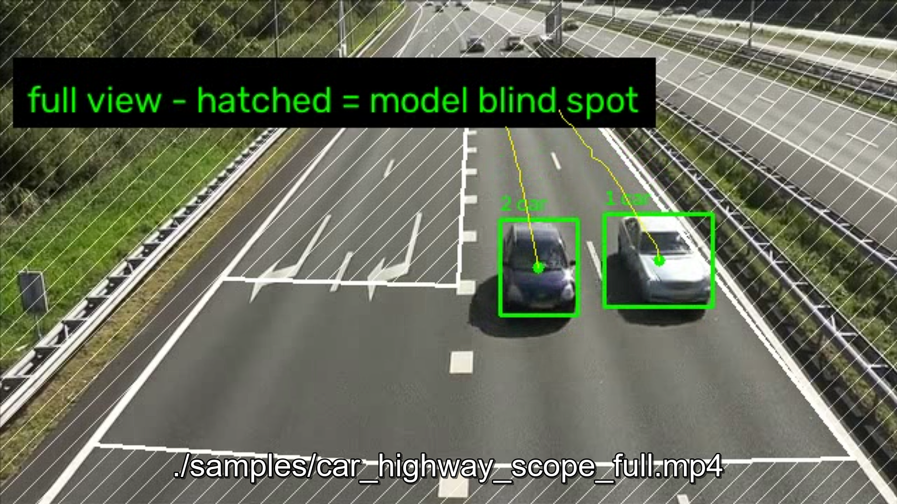

# TraceKit

**Infrastructure between your vision model and your application logic.**

You bring the detector. TraceKit gives every object a **persistent ID**, remembers its **path**, and tells you **when things happen** — crossings, zones, lingering, objects getting too close. You decide what that means.

```text
 your model ──▶ Detector adapter ──▶ normalized detections
                                          │
                            TraceKit owns this part
                                          │
              IDs · paths · positions ──▶ events ──▶ your callbacks
                                          │
                        frames stay yours — draw anything
```

## See it in one screen

Real frame from the highway demo. The hatched area is a `Scope` — the model never looks there; boxes and trails come back in full-frame coordinates anyway:



The minimal code behind that view:

```python
from tracekit import Media, Scope, YOLOAdapter, Zone

road = Zone(points=[(332, 84), (326, 203), (158, 198),
                    (64, 316), (315, 332), (608, 326), (414, 73)])

detector = Scope(YOLOAdapter(weights="yolov8n.pt"), road, margin=20)

cars = (
    Media("traffic.mp4")
    .detect(detector=detector, confidence=0.4, labels=["car"])
    .track()
)
# the model is cropped to `road`; every box comes back in full-frame
# coordinates — hatching/border are plain OpenCV in your on_update handler
```

Full runnable version (draws the hatch, border, and both views): [`examples/scope_two_views.py`](examples/scope_two_views.py).

## The whole loop, 15 lines

```python
from tracekit import Media, YOLOAdapter, Line

video = Media("traffic.mp4")
gate = Line(a=(40, 180), b=(600, 180), name="gate")

cars = video.detect(
    detector=YOLOAdapter(weights="yolov8n.pt"),  # any model stack works
    confidence=0.4,
    labels=["car"],
).track()

count = 0
def on_cross(e):
    global count
    count += 1
    print(f"car {e.track.id} crossed, going "
          f"{'down' if e.direction == -1 else 'up'}")

cars.on_cross(gate, on_cross)   # register an event, done
video.run()
```

Every car keeps an identity across frames — `car 3` is `car 3` in frame 1 and frame 500:

```python
for t in cars.tracks:            # one Track per object, right now
    t.id        # 3 — persistent
    t.position  # (421, 340)
    t.path      # [(x, y), ...] — everything it's ever been
    t.bbox      # (x1, y1, x2, y2)
```

## Events — ask *where*, get told *when*

| You want to know… | One line of setup | You get |
|---|---|---|
| it crossed a line | `cars.on_cross(line, h)` | `e.track`, `e.direction` (+1/−1) |
| it entered / left a zone | `cars.on_enter(zone, h)` · `on_exit(zone, h)` | `e.track`, `e.coverage` |
| it *lingered* in a zone | `DwellWatcher(zone, min_frames)` → `add_producer` | `dwell` / `leave` events |
| two things got too close | `cars.on_proximity(80, h)` | `e.track`, `e.other`, `e.distance` |
| it appeared / vanished | `cars.on_appear(h)` · `on_lost(h)` | `e.track` |
| everything, every frame | `cars.on_update(h)` | `e.tracks`, `e.frame` |

Every handler is just `def h(e): ...` — TraceKit detects the moment, **your handler decides what it means** (count it, alert someone, write to a DB — that part is your app).

## The model only sees what matters

Give it a `Scope` — a zone the detector is allowed to look at. YOLO (or any model) never sees the rest: less compute, fewer false detections, while tracking and visuals keep working on the **full frame**:

```python
from tracekit import Scope, Zone

road = Zone(points=[(20, 30), (545, 30), (545, 356), (20, 356)])

detector = Scope(YOLOAdapter(weights="yolov8n.pt"), road, margin=20)
cars = video.detect(detector=detector, confidence=0.4, labels=["car"]).track()
# boxes come back in full-frame coordinates — nothing else changes
```

## One runnable example per feature

Clone, install, run — each script is ~20–40 lines and prints its events to the terminal while saving an annotated video.

| Feature | Try it |
|---|---|
| Tracking basics | `python examples/basic_tracking.py your.mp4` |
| Counting line | `python examples/count_cars.py` |
| Two lanes, one counter each | `python examples/two_lines.py` |
| Zone occupancy (enter/exit) | `python examples/traffic_zone.py` |
| Dwell (stopping/lingering) | `python examples/dwell_queue.py` |
| Proximity alert | `python examples/proximity_alert.py` |
| All events at once | `python examples/highway_events.py` |
| Model sees ROI only | `python examples/road_only.py` |
| Scope, two views (full + region-only) | `python examples/scope_two_views.py` |
| Synthetic — no video needed | `python examples/events_demo.py` |
| Browser camera (WSL2-friendly) | `python examples/browser/server.py` → open `http://127.0.0.1:8000` |

## Design rules (why TraceKit feels this way)

- **Bring your own detector** — YOLO, MediaPipe, ONNX, an API, whatever. Adapt it into `Detection`, done. YOLO is an adapter, not the architecture.
- **Events notify; apps decide** — TraceKit never emails, never draws, never judges. It emits moments; you decide meanings.
- **Core never touches pixels** — rendering is your side. Examples draw with plain OpenCV.
- **Nothing runs until you ask** — every watcher is opt-in; unused features cost zero.

## Install

```bash
pip install -e ".[dev]"          # core + tests
pip install -e ".[all]"          # opencv + yolo + browser demo + tests

pytest -v                        # 53 tests, no YOLO weights needed
```

Architecture, design principles, and contribution rules: see [`AGENTS.md`](AGENTS.md). Full usage reference: [`USAGE.md`](USAGE.md).
